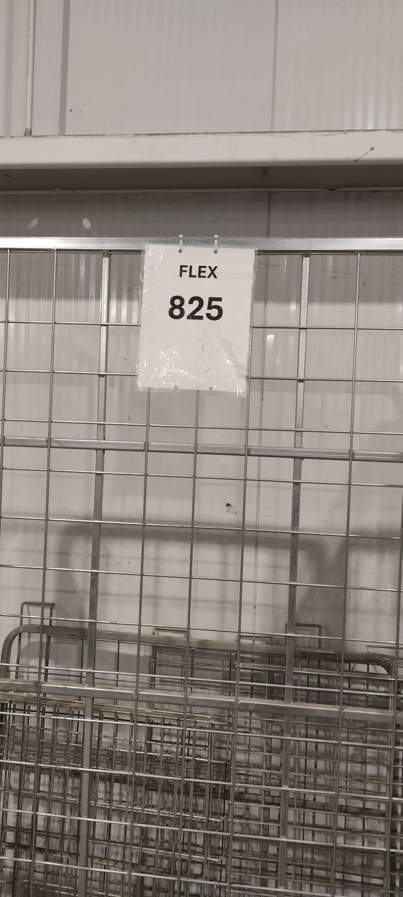
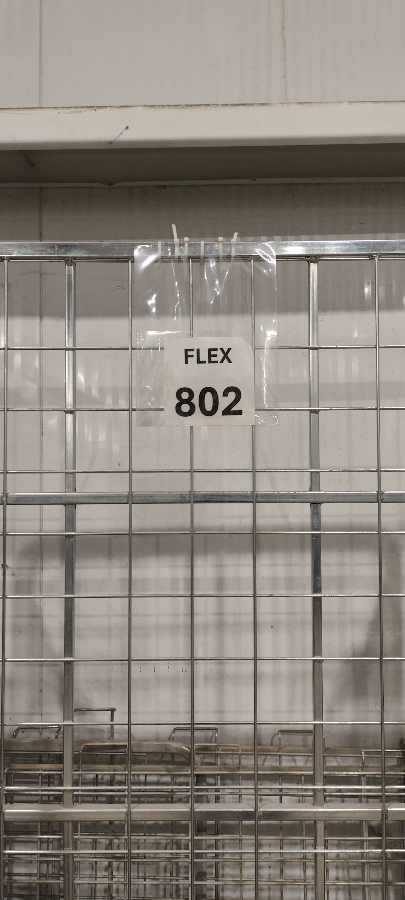

# Warehouse Efficiency Improvement Through Visual Management

**A Lean Continuous Improvement Project | FedEx Warehouse Operations**

## Project Overview

This project focused on reducing unnecessary movement and preparation time during warehouse sortation by improving how workers identify and locate numbered sortation cages.

Before the improvement, team members spent time searching different areas of the warehouse to locate specific cages required for each sort. This created unnecessary motion, delayed preparation, and increased physical effort.

To address the problem, I introduced a simple visual management solution using transparent identification pockets attached to the cages. The corresponding number tags could be inserted as soon as the sort list was generated, making cage identification easier and reducing the need for workers to search throughout the warehouse.

## Before and After Implementation

| Previous Identification Method | Improved Visual Management System |
|---|---|
|  |  |
| Original cage identification arrangement | Transparent identification pocket system |

## Problem Identified

- Workers spent unnecessary time locating specific numbered cages.
- Cages were distributed across different areas of the warehouse.
- Searching created unnecessary walking and physical effort.
- Cage retrieval added avoidable time to sort preparation.

**Lean wastes addressed:** Motion and Waiting.

## Improvement Implemented

Introduced transparent identification pockets on the cages to provide a designated location for displaying the required number tags.

**Improved workflow:**

1. Generate the sort list.
2. Identify the required cage numbers.
3. Insert the corresponding number tags into the transparent pockets.
4. Locate the required cages using their visible identification.
5. Proceed with sort preparation.

## Results and Operational Impact

| Performance Indicator | Result |
|---|---:|
| Time saved per sort | ~10 - 20 minutes |
| Cages handled per sort | 9–15 |
| Primary waste reduced | Unnecessary motion and waiting |
| Improvement approach | Visual Management |

The improvement recovered approximately 10 minutes of operational time per sort while reducing unnecessary searching and physical effort.

## Lean Methodologies Applied

- **Visual Management:** Improved the visibility of cage identification.
- **Waste Elimination:** Reduced unnecessary movement and searching.
- **Standardized Work:** Integrated tag preparation into the sort preparation process.
- **PDCA:** Applied a practical improvement and identified opportunities for performance monitoring and sustainability.

## Project Documentation

For the detailed improvement methodology, problem analysis, implementation workflow, performance results, and sustainability plan, see:

**[Read the Full Lean Improvement Report](lean-improvement-report.md)**

## Key Takeaway

Small operational improvements can deliver meaningful cumulative benefits when they eliminate recurring waste. By making warehouse resources easier to identify and locate, this project improved sort preparation through a simple, practical, and low-complexity visual management solution.

---

*Project documentation based on an improvement implemented within FedEx warehouse sortation operations.*
