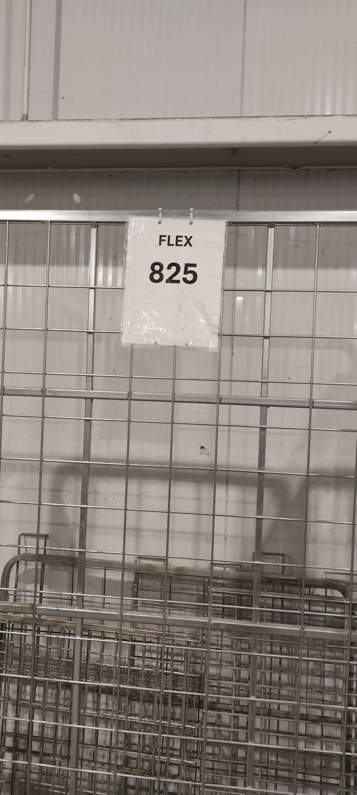
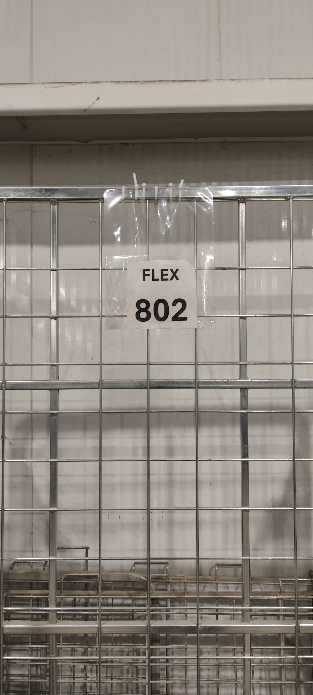

# Warehouse Efficiency Improvement Through Visual Management
### Lean Warehouse Sortation Improvement | FedEx

**Project Category:** Continuous Improvement / Lean Operations  
**Methodology:** PDCA (Plan–Do–Check–Act)  
**Lean Tools:** Visual Management, Waste Elimination, Standardized Work  
**Improvement Area:** Cage Identification and Sort Preparation

---

## 1. Visual Evidence: Before and After Implementation

The following photographs document the physical identification arrangement before and after the improvement.

### Figure 1. Previous Cage Identification System (Before)

*The previous FLEX cage identification arrangement.*

### Figure 2. Improved Transparent Pocket System (After)

*The improved arrangement allows cage number tags to be inserted into transparent identification pockets, making cage identification more straightforward.*

**Improvement demonstrated:** The introduction of designated transparent pockets provides a simple visual identification method that integrates with the existing warehouse cages and sort preparation process.

---

## 2. Executive Summary

This project addressed unnecessary time and physical effort spent locating numbered cages at the beginning of each warehouse sort.

Because the required cages were distributed across different areas of the warehouse, team members had to search for specific cage numbers before they could begin their assigned activities.

A simple visual management solution was introduced using transparent identification pockets attached to the cages. Once the sort list was generated, the corresponding number tags could be inserted into the pockets, making cage identification easier.

The improvement consistently saved approximately **10 minutes per sort**, supporting daily operations involving approximately **9–15 cages per sort**.

The solution reduced unnecessary movement, simplified cage identification, and improved the efficiency of sort preparation without requiring major equipment changes.

## 3. Problem Definition

### 3.1 Current State

At the beginning of each sort, team members needed to locate specific numbered cages, such as FLEX 802 or FLEX 825, according to the requirements of the upcoming sort.

The cages were distributed across different locations within the warehouse. Identifying and retrieving the required cages therefore involved unnecessary searching and walking before productive sorting activities could begin.

### 3.2 Operational Impact

The existing process created three forms of operational waste:

- **Motion:** Workers walked between different warehouse areas to locate specific numbered cages.
- **Waiting:** Sort preparation was delayed while workers searched for the required equipment.
- **Underutilized effort:** Physical energy was spent searching for resources rather than preparing the operation for productive work.

These activities did not directly contribute to package processing or customer value.

### 3.3 Problem Statement

The existing cage identification and retrieval process required unnecessary searching and movement at the beginning of each sort, consuming approximately 10 minutes of avoidable operational time and increasing physical effort for team members.

## 4. Root Cause Analysis

The main issue was the difficulty of identifying and locating the specific cages required for an upcoming sort.

The problem was associated with the cage identification and retrieval process rather than the physical availability of the cages themselves.

The existing approach required workers to spend time and physical effort searching throughout the warehouse to find the correct cage.

This created an opportunity to improve the process by making cage identification easier and more direct.

**Identified improvement opportunity:** Make the required cage numbers easier to display, identify, and locate through a simple visual management system.

## 5. Proposed and Implemented Countermeasure

### 5.1 Solution: Transparent Identification Pockets

Transparent identification pockets were introduced on the cages to hold their number tags.

When the sort list became available, the relevant number tags could be inserted into the pockets. This provided a simple, visible means of identifying the cages required for the upcoming sort.

### 5.2 Improved Workflow

1. **Generate the sort list:** Obtain the list of cages required for the upcoming sort.
2. **Identify required cage numbers:** Determine which cage numbers are needed.
3. **Insert identification tags:** Place the corresponding number tags into the transparent pockets.
4. **Begin sort preparation:** Reduce time spent searching and move more quickly into productive work.

### 5.3 Why the Solution Works

The improvement addresses the problem by reducing the effort needed to identify the required equipment.

Rather than relying primarily on workers searching throughout the warehouse, the process uses a simple visual aid to make identification more straightforward.

Additional practical advantages include:

- Simple implementation within the existing warehouse layout.
- Easy for team members to understand and use.
- Supports repeated daily use.
- Requires minimal additional process complexity.
- Can accommodate changing cage requirements across different sorts.

## 6. Lean Principles Applied

| Lean principle | Application |
|---|---|
| Waste elimination | Reduced unnecessary walking and searching for numbered cages. |
| Visual management | Transparent pockets make cage identification more straightforward. |
| Standardized work | Introduced a repeatable tag-insertion step after generating the sort list. |
| Point-of-use improvement | Made identification information available directly on the cage. |
| Continuous improvement | Addressed a recurring operational problem through a practical, low-complexity solution. |

The primary wastes addressed were **unnecessary motion and waiting**.

The improvement also supports smoother workflow by reducing non-value-adding preparation activities.

## 7. Results and Performance Measurement

### 7.1 Reported Results

| Performance indicator | Result |
|---|---|
| Time saved per sort | Approximately 10 minutes |
| Daily operating scale | 9–15 cages per sort |
| Identification process | Improved through transparent pockets |
| Physical effort | Reduced unnecessary walking and searching |
| Implementation | Visual identification pocket system introduced |

### 7.2 Cumulative Time Savings

Assuming the improvement consistently saves 10 - 20 minutes per sort
Actual savings depend on the number of sorts performed and the consistency of the improvement.

### 7.3 Performance Validation

To strengthen the evidence of improvement, the time required to locate the required cages can be measured before and after implementation.

**Time saved per sort = Average time before improvement − Average time after improvement**

For example, if the original process took 15 minutes and the improved process took 5 minutes, the measured saving would be 10 minutes per sort.

These times are illustrative; the reported 10-minute saving is based on the project observations.

## 8. PDCA Continuous Improvement Cycle

### Plan

Identify unnecessary searching and walking during cage retrieval at the beginning of each sort.

Recognize that cage identification could be improved through a simple visual management solution.

### Do

Introduce transparent identification pockets and integrate number-tag insertion into the sort preparation process.

### Check

Observe the cage retrieval process and compare the time required before and after implementation.

Verify whether the time savings remain consistent across different sort volumes.

### Act

Maintain the improved method if results remain positive.

Standardize the tag-insertion step and consider applying the same visual management approach to other warehouse resources that require frequent identification and retrieval.

## 9. Control and Sustainability Plan

To sustain the improvement:

1. **Standardize tag preparation:** Include number-tag insertion in the preparation activities performed after the sort list becomes available.
2. **Maintain visibility:** Ensure identification tags remain legible and correctly positioned.
3. **Assign ownership:** Establish responsibility for preparing and maintaining the tags and pockets.
4. **Monitor performance:** Periodically review the time required to locate cages and investigate any return to the previous searching process.
5. **Review applicability:** Assess whether the same approach could improve the identification of other frequently used warehouse equipment.

## 10. Conclusion

This project demonstrates how a small, practical Lean improvement can address a recurring operational problem without requiring major equipment changes or a complex technology solution.

By introducing transparent identification pockets and integrating number-tag preparation into the sort workflow, the process became easier to navigate and less dependent on unnecessary searching and walking.

The reported saving of approximately **10 minutes per sort** represents recovered operational time that can be redirected toward productive preparation and sortation activities.

Beyond the time savings, the improvement reduces avoidable physical effort for team members and demonstrates the value of applying visual management to everyday warehouse operations.

**Key takeaway:** Effective continuous improvement does not always require a major process redesign. Sometimes, making the right resource easier to identify is enough to eliminate recurring waste and improve daily operations.

---

*Prepared as an operational Lean improvement report. Performance figures are based on project observations; formal before-and-after time studies would further strengthen validation.*
